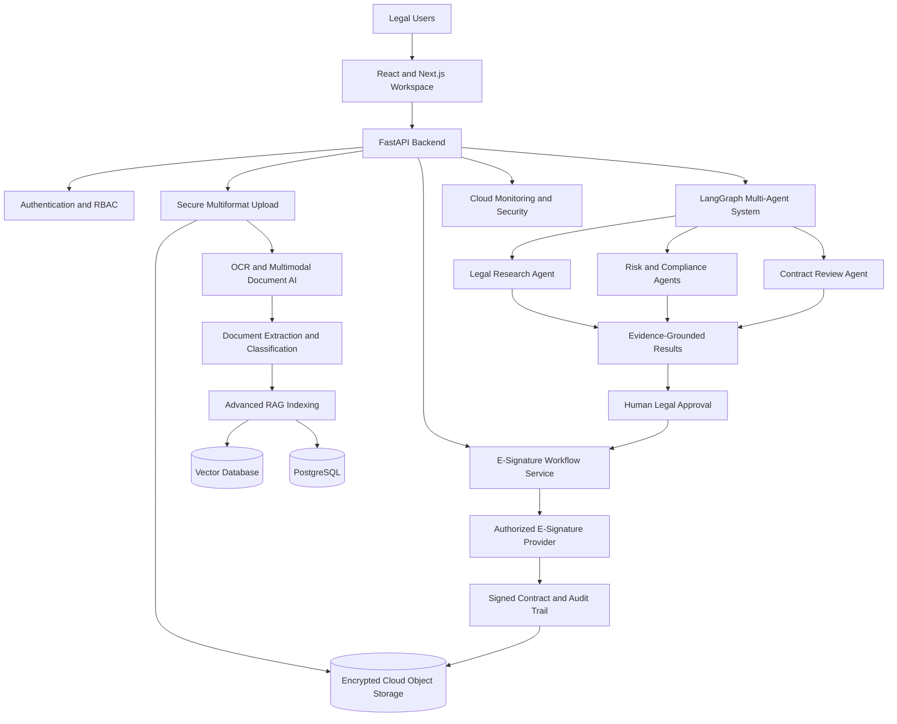

# Lexora — Enterprise Legal Document Intelligence AI

### Advanced RAG | Multi-Agent AI | Multimodal Legal AI | E-Signatures | Cloud Computing | Enterprise Security

**Project Status:** Active Development

Lexora is an enterprise-oriented AI platform designed to solve real-world legal document management challenges through Generative AI, Advanced RAG, Legal NLP, Computer Vision, Multi-Agent AI, secure cloud infrastructure, and electronic signature workflows.

## Expanded Core Features

### 1. Multiformat Document Upload and Understanding

- Upload PDF, DOCX, TXT, CSV, JSON, JPG and PNG files.
- Support scanned contracts, legal notices, agreements and document images.
- Extract text, tables, clauses, dates, parties and obligations using OCR and document AI.
- Detect duplicate documents and manage document versions.
- Enable bulk uploads, file validation and secure cloud storage.
- Analyze uploaded documents using multimodal LLMs and legal NLP.
- Generate evidence-grounded summaries, risk reports and question-answering responses.

### 2. Electronic Signatures and Contract Lifecycle Management

- Create and manage electronic signature requests.
- Support multiple signers and configurable signing sequences.
- Track pending, completed, rejected and expired signature requests.
- Add signer authentication and explicit signing consent.
- Maintain timestamped signing events and tamper-evident audit records.
- Verify document integrity using cryptographic hashes.
- Store finalized signed contracts securely.
- Trigger contract renewal reminders and obligation monitoring.

**Legal consideration:** E-signature enforceability varies by jurisdiction and document type. Lexora should use suitable trust-service providers, verify applicable legal requirements and avoid claiming universal legal validity.

### 3. Advanced RAG and Legal Knowledge Intelligence

- Hybrid BM25 and semantic vector search.
- Cross-encoder reranking and query rewriting.
- GraphRAG and legal knowledge graph exploration.
- Permission-aware document retrieval.
- Citation-grounded legal question answering.
- Contract clause comparison and obligation extraction.
- Confidence checks and insufficient-evidence handling.
- Human review for high-risk legal interpretations.

### 4. Multi-Agent Legal Workflows

- Supervisor Agent for workflow orchestration.
- Document Agent for OCR, classification and extraction.
- Legal Research Agent for evidence retrieval.
- Contract Analysis Agent for clause interpretation.
- Compliance Agent for policy checks.
- Risk Agent for identifying potential contractual risks.
- E-Signature Workflow Agent for preparing and tracking signing requests.
- Review Agent for validation and quality checks.
- Notification Agent for approvals, renewals and deadlines.

Agent actions that modify or send legally significant documents require explicit authorization and human approval.

### 5. Cloud Computing and Enterprise Infrastructure

- Cloud deployment using AWS, Azure or Google Cloud.
- Private encrypted object storage for uploaded legal files.
- PostgreSQL and vector databases for structured data and retrieval.
- Redis caching and asynchronous document processing.
- Docker-based services and CI/CD pipelines.
- Tenant isolation, RBAC and document-level access permissions.
- Cloud monitoring, backups, recovery procedures and audit logging.
- Configurable document retention and deletion policies.

### 6. Real-World Business Problems Addressed

| Business Problem | Lexora Solution |
|---|---|
| Manual legal document review | OCR, AI extraction and document intelligence |
| Delayed contract signing | E-signature requests and approval tracking |
| Scattered legal files | Centralized secure cloud storage |
| Scanned and image-based documents | Multimodal AI and OCR |
| Missed contract renewals | Automated reminders and obligation tracking |
| Difficult legal research | Advanced RAG with citations |
| Contractual and compliance risks | Specialized AI agents with human review |
| Confidential data exposure | Encryption, RBAC and tenant isolation |
| Unreliable AI conclusions | Evidence verification and legal reviewer approval |

## Updated System Architecture

## Example End-to-End Business Workflow

1. A legal manager uploads a scanned supplier agreement.
2. Lexora validates the file and stores it securely.
3. OCR and multimodal AI extract contract content.
4. Advanced RAG indexes the document for secure search.
5. Legal agents identify obligations, renewal dates and potential risks.
6. The legal reviewer verifies the findings and approves the document.
7. An authorized user initiates an electronic signature request.
8. Signers authenticate, review and sign through an integrated provider.
9. The finalized agreement and signing audit trail are stored securely.
10. Lexora tracks contract obligations, renewals and upcoming deadlines.

## Evaluation and Verification

Planned evaluations include OCR accuracy, clause extraction F1, retrieval Recall@K, citation accuracy, agent completion rates, signature workflow integrity, access-control tests, API latency and cloud reliability.

## Responsible AI and Project Status

Lexora is under active development. These expanded capabilities represent the intended architecture and feature roadmap, not verified production functionality.

Lexora supports legal professionals and authorized business users. It does not replace qualified legal counsel or independently authorize legally binding actions.

## Author

**PA Mohammed Hamil**

Generative AI Engineer | Agentic AI | Machine Learning | Full-Stack AI

GitHub: https://github.com/pa-mohammed-hamil

Portfolio: https://pa-mohammed-hamilgithubio.vercel.app
