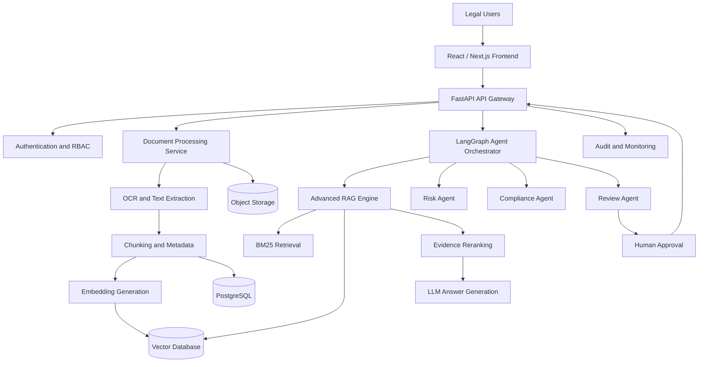
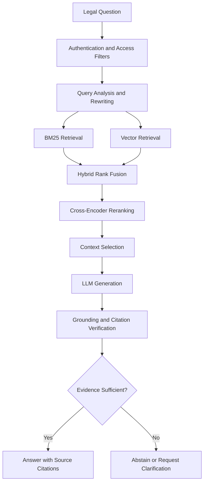
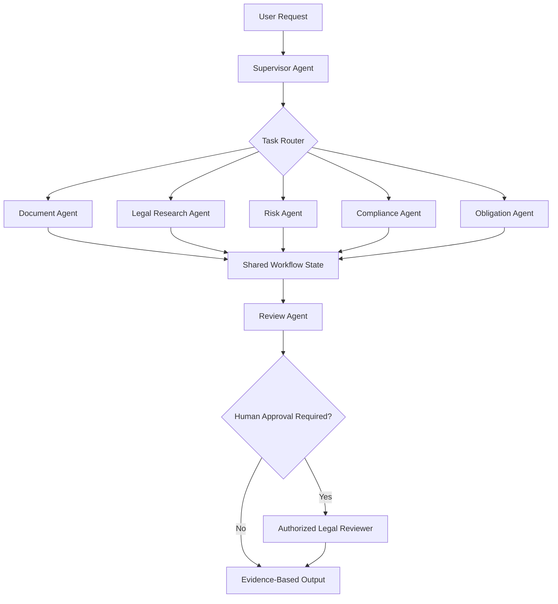

# ⚖️ Lexora — Enterprise Legal Document Intelligence AI

### Enterprise Generative AI | Advanced RAG | Multi-Agent Systems | Legal NLP | Secure Document Intelligence

**An enterprise-oriented AI platform for intelligent contract analysis, legal research, compliance monitoring, risk assessment, and automated legal document workflows.**

**Project Status:** Active Development  
**Category:** Enterprise AI / LegalTech / Generative AI  
**Architecture:** Full-Stack AI + Advanced RAG + Multi-Agent Orchestration

---

## 1. Project Overview

Lexora is an enterprise-focused Legal Document Intelligence platform designed to address real-world challenges faced by law firms, corporate legal departments, compliance teams, auditors, and businesses.

Organizations manage thousands of contracts, legal agreements, compliance documents, policies, and regulatory records. Manual document analysis is expensive, time-consuming, difficult to scale, and vulnerable to human oversight.

Lexora aims to transform traditional document workflows through:

- Advanced document understanding and legal NLP
- Retrieval-Augmented Generation with verifiable citations
- AI-powered contract and clause analysis
- Multi-agent workflow orchestration
- Automated obligation and renewal tracking
- Legal risk and compliance intelligence
- Secure, permission-aware document retrieval
- Human-supervised AI decision support

**Mission:** Make enterprise legal document management more efficient, searchable, explainable, secure, and scalable.

## 2. Real-World Business Problems

| Business Challenge | Proposed AI Solution | Expected Benefit |
|---|---|---|
| Manual contract review | OCR, NLP and clause extraction | Reduce repetitive analysis |
| Missed renewal deadlines | Date extraction and reminders | Improve obligation tracking |
| Hidden contract risks | Clause analysis and risk classification | Earlier risk identification |
| Slow legal research | Advanced hybrid RAG | Faster evidence retrieval |
| Inconsistent compliance checks | Policy-aware compliance agents | More consistent reviews |
| LLM hallucinations | Citation verification and grounding checks | More trustworthy responses |
| Confidential data exposure | RBAC and tenant isolation | Stronger access control |
| Fragmented legal workflows | Multi-agent orchestration | Better workflow coordination |

## 3. Real-World Use Case

### Enterprise Supplier Contract Review

**Scenario:** A company manages hundreds of supplier agreements with different expiry dates, payment obligations, termination clauses, and confidentiality requirements.

**Traditional approach:**

Legal teams manually open documents, identify critical clauses, compare contract versions, and track deadlines in spreadsheets.

**Lexora workflow:**

1. The legal manager uploads contracts in PDF or DOCX format.
2. The document processing service extracts text, tables, metadata, and clause structures.
3. The indexing pipeline generates embeddings and builds searchable document representations.
4. The Legal Research Agent retrieves relevant evidence.
5. The Clause Analysis Agent identifies contractual obligations and unusual clauses.
6. The Risk Agent flags potential legal and commercial risks.
7. The Compliance Agent checks documents against configured policies.
8. The Review Agent generates an evidence-linked summary.
9. High-risk findings require human verification.
10. Approved deadlines and obligations become trackable tasks.

**Expected outcome:** More efficient document review, improved deadline visibility, and evidence-supported legal decision-making.

*This scenario illustrates the intended workflow and is not a verified production deployment.*

---

## 4. Core Features

### Intelligent Document Processing

- PDF and DOCX ingestion
- Scanned document OCR
- Layout-aware document parsing
- Contract classification
- Legal entity and clause extraction
- Document metadata management
- Duplicate document detection
- Version history and comparison
- Secure document storage

### Advanced Retrieval-Augmented Generation

- Semantic vector retrieval
- BM25 keyword search
- Hybrid retrieval with rank fusion
- Cross-encoder reranking
- Query rewriting and multi-query retrieval
- Parent-child document retrieval
- Contextual compression
- Knowledge graph retrieval
- GraphRAG exploration
- Citation-grounded question answering
- Retrieval confidence and relevance evaluation
- Insufficient-evidence handling

### Multi-Agent Legal Intelligence

- Supervisor Agent
- Document Processing Agent
- Clause Analysis Agent
- Legal Research Agent
- Risk Assessment Agent
- Compliance Agent
- Contract Comparison Agent
- Obligation Tracking Agent
- Review and Quality Evaluation Agent
- Notification Agent

Agents are designed to operate through controlled tools, structured state transitions, checkpoints, and approval workflows.

### Enterprise Security

- Authentication and authorization
- Role-based access control
- Tenant-isolated data access
- Document-level permissions
- Encrypted document storage
- Secure file upload validation
- Audit logs
- Rate limiting
- Prompt injection protection
- Sensitive data handling
- Human approval for high-risk actions

---

## 5. System Architecture

**Architecture principle:** Separate document ingestion, retrieval, agent orchestration, business logic, and authorization to improve maintainability, scalability, and testability.

---

## 6. Advanced RAG Pipeline

### Retrieval Design

Lexora's planned retrieval architecture combines lexical matching and semantic similarity.

BM25 helps identify exact legal terminology, while dense vector retrieval captures semantic relationships.

Reranking prioritizes the most relevant passages before they are supplied to the language model.

Document-level access controls must be enforced before retrieval results are exposed to the model.

### Hallucination Mitigation

- Evidence-grounded generation
- Page and clause references
- Citation validation
- Structured output validation
- Retrieval quality thresholds
- Human review for legal conclusions
- Explicit uncertainty when evidence is missing

---

## 7. Agentic AI Architecture

### Agent Reliability

The orchestration layer is designed to support:

- State persistence
- Task routing
- Checkpoint recovery
- Tool permission restrictions
- Retry and timeout policies
- Structured agent outputs
- Human-in-the-loop approvals
- Agent execution tracing
- Failure handling
- Auditability

---

## 8. Technology Stack

| Category | Technologies |
|---|---|
| Programming | Python, TypeScript, SQL |
| Frontend | React, Next.js, Tailwind CSS |
| Backend | FastAPI, Pydantic, REST APIs |
| Machine Learning | PyTorch, Scikit-learn, Hugging Face |
| Generative AI | LLMs, Transformers, Prompt Engineering |
| Agentic AI | LangChain, LangGraph |
| Retrieval | Advanced RAG, BM25, Vector Search, GraphRAG |
| Database | PostgreSQL, pgvector |
| Cache / Queues | Redis, asynchronous workers |
| Document Processing | OCR, PDF/DOCX parsers |
| Infrastructure | Docker, GitHub Actions, Cloud Services |
| Monitoring | RAG Evaluation, Agent Tracing, MLOps, LLMOps |
| Security | RBAC, OIDC, Encryption, Audit Logging |

*The table represents the intended technology stack. Actual dependencies should match the repository implementation.*

---

## 9. Implementation Strategy

### Phase 1 — Document Intelligence

Implement document upload, validation, OCR, parsing, metadata extraction, document versioning, and secure storage.

### Phase 2 — Retrieval Intelligence

Implement chunking, embedding generation, vector indexing, BM25 retrieval, hybrid fusion, reranking, and source citations.

### Phase 3 — Legal AI Services

Implement clause extraction, contract comparison, obligation tracking, legal Q&A, and risk assessment.

### Phase 4 — Agentic Workflows

Introduce LangGraph-based agents, supervisor routing, checkpoints, retries, structured outputs, and human approval.

### Phase 5 — Enterprise Security

Implement authentication, tenant isolation, permission-aware retrieval, audit logs, secure storage, and security testing.

### Phase 6 — Deployment and Evaluation

Add automated testing, containerization, CI/CD, observability, benchmarks, and deployment documentation.

---

## 10. Technical Challenges and Solutions

### Challenge 1 — Unstructured Legal Documents

**Problem:** Contracts contain complex layouts, tables, scanned pages, inconsistent formatting, and specialized terminology.

**Approach:** Use OCR, layout-aware parsing, text normalization, clause segmentation, and structured metadata extraction.

### Challenge 2 — Hallucinated Legal Answers

**Problem:** LLMs can generate convincing but unsupported legal conclusions.

**Approach:** Combine hybrid retrieval, reranking, grounded prompts, citation verification, and human approval.

### Challenge 3 — Confidential Enterprise Information

**Problem:** Legal documents contain sensitive business and personal information.

**Approach:** Enforce authentication, tenant isolation, least-privilege access, encrypted storage, and auditable retrieval.

### Challenge 4 — Multi-Agent Reliability

**Problem:** Autonomous workflows may repeat actions, fail unpredictably, or produce conflicting results.

**Approach:** Use deterministic workflow boundaries, structured state, checkpoint recovery, idempotency, tool permissions, and human review.

### Challenge 5 — Large-Scale Document Processing

**Problem:** Large document collections can increase processing latency, infrastructure cost, and retrieval complexity.

**Approach:** Use asynchronous ingestion, batching, indexing strategies, caching, resource limits, and observability.

---

## 11. Evaluation and Performance

Lexora should be evaluated using reproducible datasets and documented test procedures.

| Evaluation Area | Metrics |
|---|---|
| Clause extraction | Precision, Recall, F1 |
| Legal entity extraction | Precision, Recall, F1 |
| Retrieval | Recall@K, MRR, nDCG |
| Answer quality | Faithfulness, Relevance |
| Citation quality | Citation Precision and Accuracy |
| Agent reliability | Task Completion Rate, Error Rate |
| API performance | P50/P95 Latency, Throughput |
| Security | Authorization and Isolation Tests |
| Infrastructure | Cost, Resource Usage, Availability |

### Benchmark Status

Benchmark results will be published after implementation and evaluation.

No production accuracy, cost savings, or latency improvements are claimed without supporting evidence.

---

## 12. Responsible AI and Legal Safety

Lexora is intended to assist qualified legal professionals, not replace legal counsel.

The system should:

- Distinguish source evidence from AI interpretation
- Avoid unsupported legal conclusions
- Provide traceable document citations
- Escalate high-risk findings to human reviewers
- Respect confidentiality and access restrictions
- Support auditability and data retention controls
- Avoid automatically executing legally binding decisions

---

## 13. Business Impact

Lexora is designed to help organizations:

- Reduce repetitive legal document review
- Improve contract search and information discovery
- Identify contractual obligations and risks earlier
- Track renewal deadlines more consistently
- Improve collaboration between legal and compliance teams
- Support evidence-based legal decision-making
- Standardize document review workflows
- Improve traceability and audit readiness

Quantitative business impact will require real-world evaluation.

---

## 14. Project Roadmap

- [ ] Secure document ingestion
- [ ] OCR and structured extraction
- [ ] Hybrid RAG implementation
- [ ] Citation-grounded legal Q&A
- [ ] Clause and obligation extraction
- [ ] Contract comparison
- [ ] Multi-agent orchestration
- [ ] Human approval workflows
- [ ] Enterprise authentication and RBAC
- [ ] Automated testing and RAG evaluation
- [ ] Docker deployment
- [ ] CI/CD and monitoring
- [ ] Demo video and screenshots

*Update these checkboxes as functionality is implemented and verified.*

---

## 15. Demonstration and Documentation

Planned supporting materials:

- Application dashboard screenshots
- Document upload demonstration
- Legal clause extraction results
- Citation-grounded question answering
- Multi-agent workflow execution
- Risk assessment and compliance dashboards
- RAG evaluation reports
- System architecture documentation
- API documentation
- Deployment instructions

A public demonstration should use synthetic or properly authorized legal documents.

---

## 16. Future Enhancements

- Multilingual legal document processing
- Advanced GraphRAG and legal knowledge graphs
- Regulatory change intelligence
- Contract negotiation assistance
- Enterprise document integrations
- Fine-tuned domain-specific legal models
- Advanced legal workflow analytics
- Continuous evaluation and model governance

---

## 17. Author

**PA Mohammed Hamil**

BCA Graduate — First Class, University of Calicut, 2026

**Focus:** Generative AI Engineering, Agentic AI, Machine Learning, Advanced RAG, and Full-Stack AI Development.

**GitHub:** https://github.com/pa-mohammed-hamil

**Portfolio:** https://pa-mohammed-hamilgithubio.vercel.app

---

### Disclaimer

Lexora is an AI engineering portfolio project under development. Described architectural components and capabilities may include planned functionality. It is not a substitute for professional legal advice.

**Built to explore practical, secure, explainable, and scalable enterprise AI systems.**
